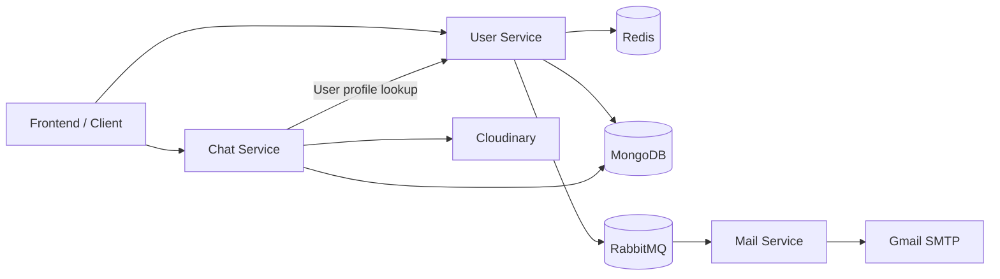

# ChatApp Backend

A TypeScript-based microservices backend for a chat application, built with **Node.js, Express, MongoDB, Redis, RabbitMQ, and Cloudinary**.

The application supports passwordless email OTP authentication, JWT-protected APIs, one-to-one conversations, message history, read receipts, and image uploads.

## Features

- **Passwordless authentication:** Request a one-time password through email and verify it to obtain a JWT.
- **Redis OTP storage:** Store OTPs with a five-minute expiry and enforce a 60-second resend interval.
- **JWT authentication:** Authenticate protected requests independently in the User and Chat services.
- **User profiles:** Retrieve profile information and update display names.
- **One-to-one chats:** Create or reuse conversations between two users.
- **Messaging:** Send and retrieve messages associated with a conversation.
- **Read receipts:** Mark incoming messages as seen when a conversation's messages are fetched.
- **Chat overview:** Retrieve conversations with their latest-message information and unseen-message counts.
- **Asynchronous email delivery:** Use RabbitMQ to pass email jobs from the User service to the Mail service.
- **Image messages:** Integrate Multer and Cloudinary for image uploads, with a 5 MB upload limit and image transformations.

## Architecture

The backend is divided into three independently configured services.



### User Service

Responsible for authentication and user management.

- Requests and verifies email OTPs.
- Stores OTPs and resend-limit information in Redis.
- Issues JWTs after successful verification.
- Provides profile lookup and display-name update endpoints.
- Publishes OTP email jobs to RabbitMQ.

### Chat Service

Responsible for conversations and messages.

- Verifies JWTs independently.
- Creates and retrieves one-to-one conversations.
- Stores messages in MongoDB.
- Tracks unseen messages and read receipts.
- Integrates with the User service for profile information.
- Uses Multer and Cloudinary for image uploads.

### Mail Service

Consumes email jobs from RabbitMQ and sends OTP emails using Nodemailer and Gmail SMTP.

## Tech Stack

| Component | Technology |
|---|---|
| Language | TypeScript |
| Runtime | Node.js with ES modules |
| HTTP framework | Express 5 |
| Database | MongoDB with Mongoose |
| OTP storage | Redis |
| Message broker | RabbitMQ with `amqplib` |
| Authentication | JWT with `jsonwebtoken` |
| Email | Nodemailer and Gmail SMTP |
| File uploads | Multer |
| Image storage | Cloudinary |
| Inter-service HTTP | Axios |

## Project Structure

```text
Backend/
├── user/
│   ├── src/
│   │   ├── config/
│   │   ├── controllers/
│   │   ├── middleware/
│   │   ├── model/
│   │   ├── routes/
│   │   ├── types/
│   │   └── index.ts
│   ├── package.json
│   ├── package-lock.json
│   └── tsconfig.json
│
├── chat/
│   ├── src/
│   │   ├── config/
│   │   ├── controllers/
│   │   ├── middlewares/
│   │   ├── models/
│   │   ├── routes/
│   │   └── index.ts
│   ├── package.json
│   ├── package-lock.json
│   └── tsconfig.json
│
├── mail/
│   ├── src/
│   │   ├── consumer.ts
│   │   └── index.ts
│   ├── package.json
│   ├── package-lock.json
│   └── tsconfig.json
│
├── .gitignore
└── README.md
```

Each service has its own dependencies, TypeScript configuration, build script, and startup command.

## Prerequisites

- Node.js and npm
- MongoDB
- Redis
- RabbitMQ
- A Cloudinary account for image storage
- A Gmail account with two-step verification and an App Password for email delivery

### Start local infrastructure

If Docker is installed, you can run the infrastructure services locally:

```bash
docker run -d --name chat-mongo \
  -p 27017:27017 mongo:7

docker run -d --name chat-redis \
  -p 6379:6379 redis:7

docker run -d --name chat-rabbit \
  -p 5672:5672 \
  -p 15672:15672 \
  rabbitmq:3-management
```

These commands are for local development. The services must be configured to connect to the corresponding running instances.

## Environment Configuration

Each service requires its own `.env` file. Create these files locally and populate them with your own configuration.

### `user/.env`

```dotenv
PORT=5000
MONGO_URI=mongodb://localhost:27017/chatApp
JWT_SECRET=replace_with_a_long_random_secret
REDIS_URL=redis://localhost:6379

Rabbitmq_Host=localhost
Rabbitmq_Username=guest
Rabbitmq_Password=guest
```

### `chat/.env`

```dotenv
PORT=5002
MONGO_URI=mongodb://localhost:27017/chatApp
JWT_SECRET=replace_with_the_same_jwt_secret
USER_SERVICE=http://localhost:5000

CLOUD_NAME=your_cloudinary_cloud_name
API_KEY=your_cloudinary_api_key
API_SECRET=your_cloudinary_api_secret
```

### `mail/.env`

```dotenv
PORT=5001

Rabbitmq_Host=localhost
Rabbitmq_Username=guest
Rabbitmq_Password=guest

EMAIL_USER=your_gmail_address
PASSWORD=your_gmail_app_password
```

**Important:**

- `JWT_SECRET` must match between the User and Chat services.
- Use a Gmail App Password rather than your normal Gmail password.
- RabbitMQ credentials must match the broker configuration.
- The RabbitMQ connection currently uses plain AMQP on port `5672`.
- The RabbitMQ host variable expects a hostname; for local development, use `localhost`.
- The Chat service expects `USER_SERVICE` to be the User service's base URL without `/api/v1`.
- The MongoDB database name `chatApp` is configured in the application code.

Never commit real `.env` files or credentials to GitHub.

## Installation and Development

Open three terminals from the `Backend` directory.

### 1. Start the Mail service

```bash
cd mail
npm install
npm run build
npm start
```

### 2. Start the User service

```bash
cd user
npm install
npm run build
npm start
```

### 3. Start the Chat service

```bash
cd chat
npm install
npm run build
npm start
```

Create each service's `.env` file before starting it. Ensure MongoDB, Redis, and RabbitMQ are running and accessible.

The services use TypeScript compilation to generate JavaScript in `dist/`, which is then executed by Node.js.

## API Reference

All API routes are prefixed with `/api/v1`.

### User Service — default port `5000`

| Method | Endpoint | Authentication | Purpose |
|---|---|---|---|
| `POST` | `/api/v1/login` | No | Request an email OTP |
| `POST` | `/api/v1/verify` | No | Verify the OTP and obtain a JWT |
| `GET` | `/api/v1/me` | Bearer JWT | Retrieve the current user's profile |
| `GET` | `/api/v1/user/all` | Bearer JWT | Retrieve user records |
| `GET` | `/api/v1/user/:id` | No | Retrieve a user by ID |
| `POST` | `/api/v1/update/user` | Bearer JWT | Update the display name |

### Chat Service — default port `5002`

| Method | Endpoint | Authentication | Purpose |
|---|---|---|---|
| `POST` | `/api/v1/chat/new` | Bearer JWT | Create or retrieve a one-to-one chat |
| `GET` | `/api/v1/chat/all` | Bearer JWT | Retrieve the current user's chats |
| `POST` | `/api/v1/message` | Bearer JWT | Send a message, optionally with an image |
| `GET` | `/api/v1/message/:chatId` | Bearer JWT | Retrieve messages for a chat |

The message endpoint accepts multipart form data when an image is included. The upload field name is `image`.

## Example API Flow

### 1. Request an OTP

```bash
curl -X POST http://localhost:5000/api/v1/login \
  -H "Content-Type: application/json" \
  -d '{"email":"you@example.com"}'
```

Check your email for the OTP.

### 2. Verify the OTP

```bash
curl -X POST http://localhost:5000/api/v1/verify \
  -H "Content-Type: application/json" \
  -d '{"email":"you@example.com","otp":"123456"}'
```

Use the JWT returned by a successful verification response for protected endpoints.

### 3. Retrieve chats

```bash
curl http://localhost:5002/api/v1/chat/all \
  -H "Authorization: Bearer YOUR_JWT_TOKEN"
```

Replace `YOUR_JWT_TOKEN` with the token returned by the verification endpoint.

## Build and Testing

Each service supports a TypeScript build:

```bash
npm run build
```

Run this command from the individual service directory.

Type-checking without generating build output can also be performed using:

```bash
npx tsc --noEmit
```

Automated tests have not yet been implemented.

## Current Scope and Roadmap

The project focuses on core backend functionality and service separation. The current implementation is a work in progress and is intended as a learning and portfolio project.

Planned improvements include:

- Real-time message delivery using WebSockets or Socket.IO
- Group conversations
- Message pagination and deletion
- Request validation and improved error handling
- Automated tests
- Docker Compose and CI
- Health checks, improved service startup, and delivery retry handling
- Stronger access controls and rate limiting
